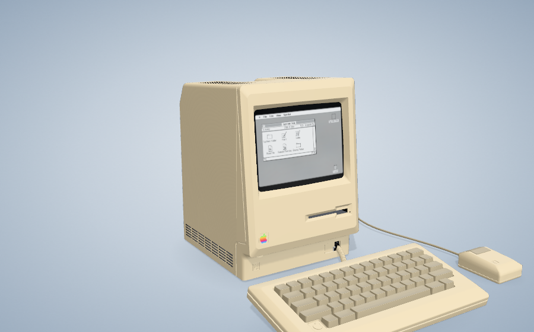
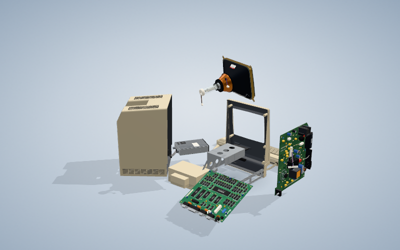
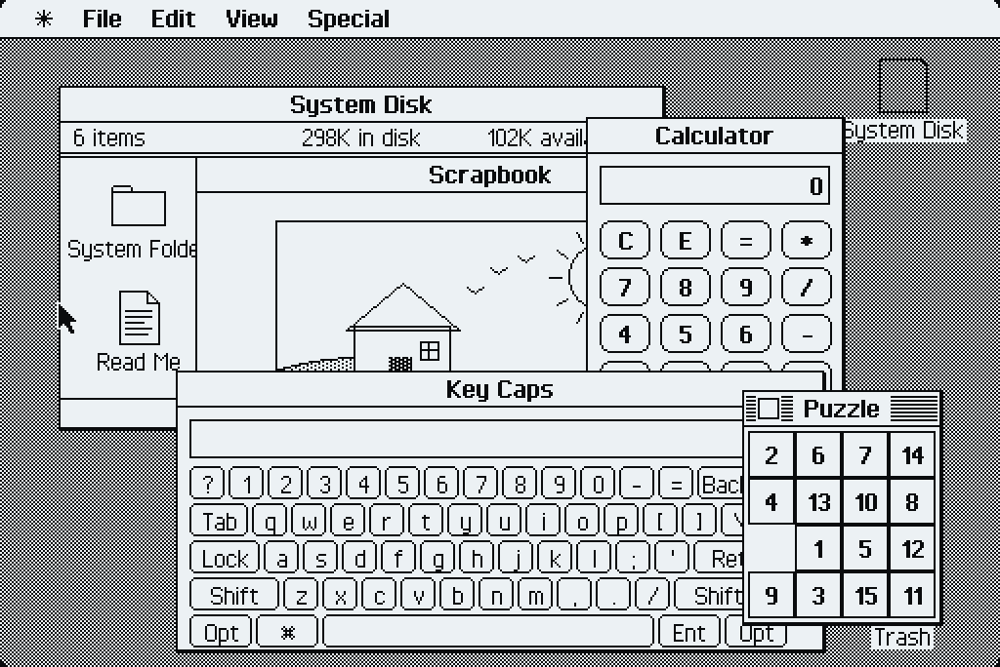
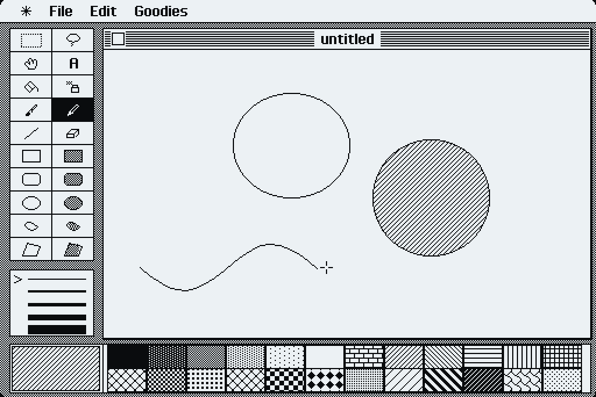

# Inside a Macintosh

Take apart a 1984 Macintosh 128K in 3D, then use the desktop on its screen.

Open `index.html` in a browser.

- Drag to rotate, scroll to zoom
- Double-click a part, then drag it out
- Click the screen to use the Mac

Build: `npm install && npm run build`

## Live site

https://em0v0.github.io/InsideAMacintosh/

Use the top switcher to open either teardown. Switching loads the other page and resets the current assembly.

GitHub Pages publishes automatically from `main` / root. After changing source files, run `npm run build` and commit the generated `index.html`. The switcher is maintained in `src/template.html`.
